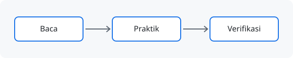

import Callout from '../../components/Callout.astro';

## Pengantar

Lab ini adalah **contoh format**. Setiap heading level dua (`##`) otomatis menjadi satu step, lengkap dengan navigasi di sidebar dan tombol Back/Next.

Yang akan kamu pelajari:

- Struktur file lab
- Cara menambah step
- Cara memakai komponen seperti `Callout`, blok kode, dan gambar

<Callout type="note">
  Hapus atau ganti file ini setelah materi pertama siap.
</Callout>

## Struktur File

Setiap lab adalah satu file `.mdx` di `src/content/labs/`. Nama file menjadi URL-nya:

```text
src/content/labs/contoh-lab.mdx  ->  /labs/contoh-lab/
```

Bagian frontmatter di atas file wajib diisi:

| Field      | Keterangan                                   |
| ---------- | -------------------------------------------- |
| `title`    | Judul lab                                    |
| `summary`  | Deskripsi singkat di halaman daftar lab      |
| `duration` | Total estimasi waktu (menit)                 |
| `level`    | `beginner`, `intermediate`, atau `advanced`  |
| `tags`     | Daftar tag (opsional)                        |
| `updated`  | Tanggal terakhir diperbarui                  |

## Menulis Step

Tulis setiap step diawali `##`. Gunakan `###` untuk sub-bagian di dalam satu step.

### Blok kode

```bash
npm run dev
```

```js
function sapa(nama) {
  return `Halo, ${nama}!`;
}
```

<Callout type="tip">
  Estimasi sisa waktu di sidebar dihitung dari `duration`, dibagi proporsional sesuai panjang tiap step.
</Callout>

## Gambar

Simpan gambar di `src/content/labs/images/<slug>/` lalu rujuk dengan path relatif. Astro akan memproses path-nya sehingga tetap benar di GitHub Pages.



<Callout type="warning">
  Jangan pakai path absolut seperti `/images/...` karena akan rusak saat situs berada di sub-path.
</Callout>

## Penutup

Selesai! Kamu sudah melihat semua elemen dasar sebuah lab. Klik **Done** untuk kembali ke daftar lab.
